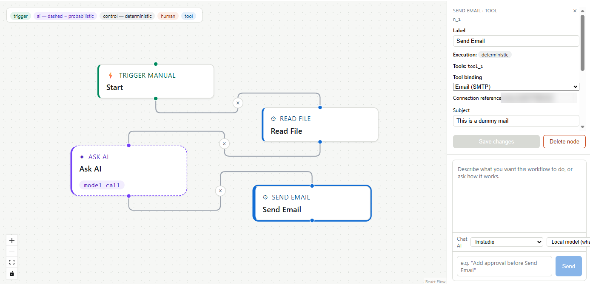

# Agentic Workflow Platform

**A visual, node-based environment for designing and running AI-powered workflows.**

This project explores a flexible way to build agentic systems: compose triggers, deterministic control flow, AI reasoning, human approval, and external tools as connected nodes in a visual workflow. A natural-language assistant is also available in the editor to help create and modify workflows.

> **Prototype status:** This is an actively developed prototype, not a production-ready automation platform. The canvas and workflow infrastructure are in place, and selected backend capabilities have real implementations. However, **many node types currently serve as UI/demo placeholders or have incomplete execution support**. The roadmap below distinguishes the current foundation from planned work.

## Demo

The screenshot below shows the visual workflow editor with a sample flow containing a manual trigger, file-reading node, AI node, and email tool node. It demonstrates the canvas, node categories, connections, node inspector, and natural-language workflow chat.



*Illustrative prototype screenshot. The presence of a node in the editor does not necessarily mean its full production execution is implemented.*

## What this project is

The goal is to make agent workflows understandable and editable as graphs rather than hiding all orchestration inside a single prompt or a large block of code.

A workflow can combine different kinds of steps:

- **Triggers** to start a workflow.
- **Control-flow nodes** for deterministic routing and conditions.
- **AI nodes** for model-driven reasoning or generation.
- **Human-in-the-loop nodes** for review and approval.
- **Tool nodes** for interacting with external services or executing actions.

The visual editor is paired with a backend workflow specification and compiler/runtime. The intention is for the canvas and the natural-language builder to operate on the same workflow definition.

## Current foundation

The following capabilities are represented in the current codebase. Their depth varies by feature, and individual integrations may require local configuration.

- **Visual workflow editor** built with React, TypeScript, and React Flow.
- **Node and edge editing**, including an inspector for configuring selected workflow elements.
- **Natural-language workflow assistant** for describing changes and applying structured workflow mutations.
- **Shared workflow specification** with JSON Schema, TypeScript types, and Pydantic models.
- **Backend validation and compilation** for translating workflow specifications into executable graphs.
- **LangGraph-based execution foundation** with state and trace handling.
- **Tool registry and node/tool compatibility checks.**
- **Tool binding modes** that distinguish explicit demo/stub behavior from connected integrations.
- **Credential references** so workflow definitions can refer to credentials without embedding secret values.
- **Approval and execution-event foundations**, including streaming run updates.
- **Persistence foundations**, including PostgreSQL-backed storage.
- **Example workflow definitions** and sample invoice data.

### Important implementation note

The node palette and editor are ahead of the implementation of some node executors. Some nodes are currently placeholders, demos, or partially wired components. A node being selectable or configurable in the UI should not be interpreted as proof that the corresponding real-world action is fully implemented. The roadmap tracks this gap explicitly.

## Architecture at a glance

```text
┌─────────────────────────────────────────────┐
│             React + TypeScript UI           │
│                                             │
│  Visual Canvas  ·  Node Inspector  ·  Chat  │
└──────────────────────┬──────────────────────┘
                       │ Workflow spec / mutations
                       ▼
┌─────────────────────────────────────────────┐
│                 FastAPI API                 │
│                                             │
│  Validation · Mutation Engine · Tool Registry│
└──────────────────────┬──────────────────────┘
                       ▼
┌─────────────────────────────────────────────┐
│            Workflow Compiler                │
│                                             │
│       Agent Specification → LangGraph       │
└──────────────────────┬──────────────────────┘
                       ▼
┌─────────────────────────────────────────────┐
│             Execution Runtime               │
│                                             │
│   State · Executors · Traces · Approvals    │
└──────────────────────┬──────────────────────┘
                       ▼
┌─────────────────────────────────────────────┐
│       Tools · AI Providers · Persistence    │
└─────────────────────────────────────────────┘
```

### Main technologies

| Layer | Technologies |
|---|---|
| Frontend | React, TypeScript, Vite |
| Workflow canvas | React Flow (`@xyflow/react`) |
| Backend API | Python, FastAPI, Pydantic |
| Workflow execution | LangGraph |
| AI providers | Provider adapters for supported model services |
| Persistence | Local development storage and PostgreSQL support |
| Workflow contract | JSON Schema, TypeScript, Pydantic |

### Repository structure

```text
agent-platform/
├── packages/
│   ├── app/              # Vite frontend application
│   ├── canvas/           # Visual workflow editor and UI components
│   └── shared-types/     # Shared workflow types
├── backend/
│   ├── api/              # FastAPI application and API routes
│   ├── compiler/         # Workflow validation and graph compilation
│   ├── tools/             # Tool registry and contracts
│   ├── credentials/      # Credential references and OAuth support
│   ├── ai_providers/     # AI provider adapters
│   ├── mutation/         # Workflow mutation engine
│   ├── nl_compiler/      # Natural-language workflow mutation
│   ├── persistence/      # Persistence implementations
│   └── real_executors/   # Tool and AI executor implementations
├── schema/               # Canonical workflow JSON Schema
├── examples/             # Example workflow specifications and data
├── docs/                 # Project documentation and screenshots
├── .env.example          # Environment configuration template
└── package.json          # npm workspaces and root scripts
```

## Getting started

### Prerequisites

- Node.js 20 or newer
- npm
- Python 3.10 or newer
- PostgreSQL only if using the PostgreSQL persistence configuration
- API credentials for the AI providers or integrations you want to connect

### 1. Clone the repository

```bash
git clone https://github.com/<your-username>/<your-repository>.git
cd <your-repository>
```

### 2. Set up the backend

Create and activate a virtual environment:

```bash
python -m venv .venv
```

Windows PowerShell:

```powershell
.venv\Scripts\Activate.ps1
```

macOS/Linux:

```bash
source .venv/bin/activate
```

Install Python dependencies and start the API:

```bash
pip install -r backend/requirements.txt
uvicorn backend.api.app:app --reload
```

The API should be available at `http://localhost:8000`.

### 3. Set up the frontend

Open a second terminal in the repository root:

```bash
npm install
npm run dev
```

Vite will print the local development URL, normally `http://localhost:5173`.

### 4. Configure integrations

Start with `.env.example` as a reference and create a local `.env` only for the integrations you intend to use. Check the relevant provider and integration code for the exact variables and callback configuration required by your setup.

**Never commit `.env`, API keys, OAuth secrets, access tokens, refresh tokens, or real user credentials.**

## Useful development commands

Run these from the repository root unless noted otherwise:

```bash
# Start frontend
npm run dev

# Build frontend
npm run build

# Type-check workspaces
npm run typecheck

# Canvas unit tests
npm run test:canvas

# Canvas integration tests
npm run test:canvas:integration

# Validate example workflow specifications
python backend/validation/check_examples.py

# Run backend examples (macOS/Linux)
PYTHONPATH=. python backend/run_examples.py
```

Some backend tests and integration paths may require additional environment configuration.

## Roadmap

This roadmap is intentionally honest about the prototype stage. The node catalogue is broader than the set of fully implemented real executors. The priority is to make each node's behavior reliable before expanding the catalogue further.

### Phase 1: Stabilise the workflow core

- [x] Establish a shared workflow specification across frontend and backend.
- [x] Build the visual workflow canvas and node inspector.
- [x] Add backend workflow validation and graph compilation foundations.
- [x] Add a tool registry and tool-binding validation.
- [x] Introduce explicit demo versus connected tool-binding modes.
- [x] Add workflow mutation foundations for natural-language editing.
- [ ] Complete end-to-end tests for the most common workflow paths.
- [ ] Improve validation and error messages shown directly on the canvas.
- [ ] Add reliable save, load, duplicate, and version-management UX.

### Phase 2: Turn placeholder nodes into working nodes

- [ ] Audit every node type and label it as **implemented**, **partial**, **demo**, or **planned**.
- [ ] Define consistent input/output contracts for every node.
- [ ] Implement and test core control-flow nodes.
- [ ] Complete AI/model-call node execution and structured outputs.
- [ ] Complete file and document nodes, including common formats.
- [ ] Complete email nodes with safe test/send behavior.
- [ ] Implement human approval and review steps end to end.
- [ ] Add clear runtime feedback for unsupported or unconfigured nodes.

### Phase 3: Expand integrations and tools

- [ ] Harden the tool registry and executor interface.
- [ ] Add more real tool integrations (only expose nodes once their execution path is usable).
- [ ] Improve credential setup, refresh, revocation, and connection status.
- [ ] Add retries, timeouts, rate-limit handling, and idempotency where appropriate.
- [ ] Add integration-level tests using mocked services.

### Phase 4: Improve the agent-building experience

- [ ] Improve natural-language workflow generation and editing.
- [ ] Add workflow suggestions and explain-why descriptions.
- [ ] Support reusable subflows/components.
- [ ] Add templates for common tasks such as research, document processing, and email triage.
- [ ] Improve auto-layout, grouping, and large-workflow navigation.

### Phase 5: Production readiness

- [ ] Implement real user authentication and authorization.
- [ ] Isolate user data, workflows, runs, and credentials.
- [ ] Store secrets using a production-grade secret-management approach.
- [ ] Add audit logs and configurable approval policies.
- [ ] Add deployment configuration, observability, and operational monitoring.
- [ ] Perform security review and threat modelling before public deployment.

## Security and limitations

This repository is an experimental prototype. **Do not expose it as a public automation service or connect sensitive accounts in an untrusted environment.**

- The current `X-User-Id` request header is an ownership/context hint, **not authentication**.
- Do not treat UI visibility, node configuration, or a successful demo run as proof of production readiness.
- Keep provider keys, OAuth secrets, tokens, database credentials, and local credential stores out of Git.
- Configure CORS narrowly for local or trusted frontend origins.
- Review executor behavior and permissions before enabling actions against real accounts or data.
- Add proper authentication, authorization, tenant isolation, secret management, and auditability before multi-user deployment.

## Contributing

Issues and pull requests are welcome. For substantial changes, consider opening an issue first to discuss the node contract, execution behavior, and tests.

When adding a node, aim to include:

1. A clear purpose and documented input/output contract.
2. Frontend configuration and validation.
3. Backend registry and executor support, where applicable.
4. Explicit demo/connected behavior if the node interacts with external services.
5. Tests for success, failure, and invalid configuration.

## License

No license has been selected yet. Until a license is added, all rights are reserved by the copyright holder; do not assume the repository is open for reuse. Add a license file before inviting external contributions or permitting reuse.
